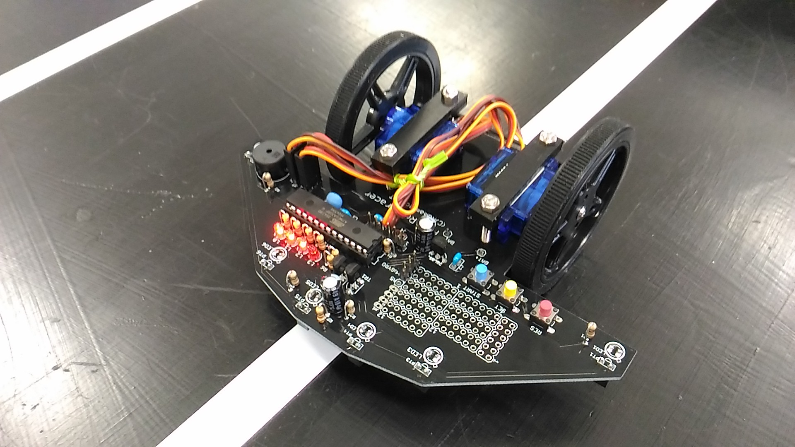

# ardurobotracer

Arudino-IDEを使ったロボトレーサです。ロボトレーサとは、マイクロマウス大会で行われているライントレースのロボット競技でロボトレースとして競技ルールが決められ、これに対応したロボットを作成しました。マイコンはArduinoUNOかブートローダー書き込み済みATmega328Pで専用に作った基板を使用し、アナログポートにライン読み取り用とマーカー読み取り用のセンサを接続、デジタル出力端子でサーボ信号を出力て連続回転サーボモータを車輪として左右に装備して走ります。そのほか、スイッチ入力と状態表示用のLEDを4個を備えています。

